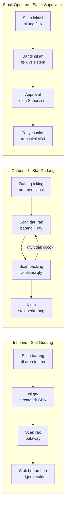
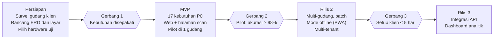

# PRD — Sistem Pergudangan Berbasis Barcode

12 November 2026 · Rahmat

## Ringkasan Produk

Produk ini adalah sistem gudang sepenuhnya berbasis web, tanpa aplikasi yang perlu diinstal, di mana setiap barang dan lokasi rak memiliki barcode, dan setiap scan dari scanner USB atau Bluetooth di browser langsung tercatat sebagai pergerakan stok (masuk, keluar, transfer, penyesuaian). Sistem dibangun sebagai satu inti yang dapat dikonfigurasi agar bisa dijual ke banyak klien.

**Masalah yang diselesaikan**

- Pencatatan stok manual (kertas atau Excel) lambat dan sering salah ketik.
- Selisih stok sulit dilacak karena tidak ada riwayat siapa, kapan, dan di mana barang dipindahkan.
- Barang sulit ditemukan karena lokasi rak tidak tercatat.
- Laporan stok harus disusun ulang secara manual setiap periode.

**Peluang**

Permintaan pembuatan sistem serupa datang dari beberapa calon klien sekaligus. Kebutuhan inti mereka sama (scan masuk, scan keluar, stok real-time), sehingga satu produk template dengan konfigurasi per klien lebih efisien daripada membangun dari nol untuk setiap proyek.

## Tujuan dan Metrik Keberhasilan

Tujuan utama adalah akurasi stok di atas 98% dan proses scan yang lebih cepat daripada pencatatan manual. Target di bawah adalah usulan awal dan perlu disepakati dengan tiap klien.

| Tujuan | Metrik | Target awal |
| --- | --- | --- |
| Stok akurat | Akurasi stock opname (fisik vs sistem) | ≥ 98% per lokasi |
| Proses cepat | Waktu rata-rata satu scan hingga tercatat | < 2 detik |
| Penerimaan efisien | Waktu proses satu dokumen penerimaan | Turun ≥ 50% dari proses manual |
| Minim salah kirim | Kesalahan picking per 1.000 item | < 5 |
| Mudah dipakai | Staf baru bisa scan mandiri setelah pelatihan | ≤ 1 jam pelatihan |
| Produk bisa diulang | Waktu setup klien baru | ≤ 5 hari kerja |

## Pengguna dan Persona

Sasaran utama adalah UMKM hingga perusahaan menengah dengan 1–5 gudang, misalnya distributor, toko grosir, dan usaha e-commerce. Ada empat peran pengguna di dalam sistem.

| Persona | Peran | Kebutuhan utama | Perangkat |
| --- | --- | --- | --- |
| Staf Gudang | Menerima, menyimpan, mengambil, dan mengirim barang | Scan cepat, layar sederhana, umpan balik jelas saat scan berhasil/gagal | Browser di PC, tablet, atau PDA + scanner USB/Bluetooth |
| Supervisor Gudang | Mengawasi operasi harian dan menyetujui penyesuaian | Pantau dokumen berjalan, setujui selisih opname, lihat kinerja staf | Web (laptop/tablet) |
| Admin / Pemilik Usaha | Mengelola master data dan melihat laporan | Laporan stok, nilai persediaan, notifikasi stok minimum | Web |
| Super Admin (Penyedia) | Mengelola klien (tenant) dan konfigurasi | Buat tenant baru, aktifkan fitur per paket, pantau penggunaan | Web |

## Ruang Lingkup

MVP fokus pada siklus inti satu gudang: barang masuk, tersimpan di rak, keluar, dan diopname. Fitur lain masuk rilis berikutnya.

**Termasuk dalam MVP**

- Master barang, satuan, kategori, dan lokasi (gudang, zona, rak, bin)
- Generate dan cetak label barcode barang serta lokasi
- Halaman scan web untuk staf: kolom input selalu fokus untuk scanner keyboard wedge, umpan balik bunyi, cadangan scan via kamera HP
- Penerimaan barang via scan dengan dokumen GRN
- Putaway (penempatan ke rak) via scan
- Barang keluar via scan: picking dan verifikasi packing
- Transfer antar lokasi dalam satu gudang
- Stock opname dan penyesuaian selisih
- Kartu stok, laporan stok per lokasi, dan notifikasi stok minimum
- Manajemen user, peran, dan log aktivitas

**Di luar MVP (rilis berikutnya)**

- Multi-gudang dan transfer antar gudang
- Batch, tanggal kedaluwarsa, serta aturan FIFO/FEFO
- Mode offline (PWA) untuk area gudang bersinyal lemah
- Multi-tenant dan pengaturan paket berlangganan
- Integrasi marketplace dan software akuntansi
- Dashboard analitik lanjutan

**Tidak direncanakan**

- Aplikasi mobile native (Android/iOS); semua perangkat memakai browser
- Modul akuntansi atau penggajian penuh
- Manajemen armada dan pelacakan pengiriman (GPS)
- Teknologi RFID

## User Stories

Setiap story memiliki kriteria penerimaan yang bisa diuji langsung di gudang.

| ID | Sebagai | Saya ingin | Kriteria penerimaan |
| --- | --- | --- | --- |
| US-01 | Staf Gudang | Scan barang saat penerimaan dan memasukkan qty | Item tercatat di GRN; barcode tak dikenal ditolak dengan pesan dan bunyi error |
| US-02 | Staf Gudang | Scan lokasi rak lalu scan barang saat putaway | Stok berpindah dari area penerimaan ke rak; tercatat di kartu stok |
| US-03 | Staf Gudang | Melihat daftar picking beserta lokasi raknya | Daftar diurutkan per lokasi; scan barang yang salah diberi peringatan |
| US-04 | Staf Gudang | Scan verifikasi saat packing | Qty scan harus sama dengan pesanan sebelum dokumen bisa dikirim |
| US-05 | Staf Gudang | Melakukan opname dengan scan per lokasi | Hasil hitung tersimpan per lokasi; bisa dilanjutkan jika terputus |
| US-06 | Supervisor | Meninjau dan menyetujui selisih opname | Penyesuaian stok hanya terjadi setelah disetujui, dengan alasan wajib diisi |
| US-07 | Supervisor | Memantau dokumen yang sedang berjalan | Status draft, proses, dan selesai terlihat real-time |
| US-08 | Admin | Mengelola master barang dan mencetak label | Label tercetak sesuai ukuran printer; satu barang bisa punya beberapa barcode |
| US-09 | Admin | Menerima notifikasi stok minimum | Notifikasi muncul saat stok ≤ batas minimum barang |
| US-10 | Admin | Melihat kartu stok dan export laporan | Laporan bisa difilter per barang, lokasi, tanggal; export ke Excel dan PDF |
| US-11 | Admin | Mengatur user dan peran | Staf hanya bisa mengakses menu sesuai perannya |
| US-12 | Super Admin | Membuat klien baru dari template | Klien baru aktif dengan data terpisah tanpa perubahan kode |

## Kebutuhan Fungsional

Ada 22 kebutuhan dalam tujuh modul; 17 di antaranya P0 dan wajib ada di MVP.

| ID | Modul | Kebutuhan | Prioritas |
| --- | --- | --- | --- |
| FR-01 | Master Data | CRUD barang: SKU, nama, satuan, kategori, stok minimum, foto | P0 – MVP |
| FR-02 | Master Data | Beberapa barcode per barang (pcs, dus) dengan konversi satuan | P0 – MVP |
| FR-03 | Master Data | Hierarki lokasi gudang, zona, rak, bin; tiap lokasi berbarcode | P0 – MVP |
| FR-04 | Master Data | Import master barang dan lokasi dari Excel | P0 – MVP |
| FR-05 | Label | Generate barcode Code 128, EAN-13, dan QR | P0 – MVP |
| FR-06 | Label | Cetak label ke printer thermal (ZPL/TSPL) dan ke PDF | P0 – MVP |
| FR-07 | Inbound | Dokumen penerimaan (GRN): scan item, qty, supplier, no. referensi | P0 – MVP |
| FR-08 | Inbound | Putaway: scan lokasi lalu scan barang | P0 – MVP |
| FR-09 | Outbound | Dokumen pesanan keluar dan daftar picking diurutkan per lokasi | P0 – MVP |
| FR-10 | Outbound | Verifikasi packing via scan dan cetak surat jalan | P0 – MVP |
| FR-11 | Inventori | Transfer antar lokasi dalam satu gudang | P0 – MVP |
| FR-12 | Inventori | Stock opname per lokasi dengan approval selisih | P0 – MVP |
| FR-13 | Inventori | Transfer antar gudang dengan status dalam perjalanan | P1 – Rilis 2 |
| FR-14 | Inventori | Batch, tanggal kedaluwarsa, saran picking FIFO/FEFO | P1 – Rilis 2 |
| FR-15 | Laporan | Kartu stok, stok per lokasi, export Excel dan PDF | P0 – MVP |
| FR-16 | Laporan | Notifikasi stok minimum (dalam aplikasi dan email) | P0 – MVP |
| FR-17 | Laporan | Dashboard analitik: slow moving, perputaran stok, akurasi opname | P2 – Rilis 3 |
| FR-18 | Sistem | Manajemen user, peran, dan hak akses per menu | P0 – MVP |
| FR-19 | Sistem | Log aktivitas setiap transaksi dan perubahan data | P0 – MVP |
| FR-20 | Scan | Halaman scan web: input selalu fokus, umpan balik bunyi, cadangan kamera HP | P0 – MVP |
| FR-21 | Sistem | Multi-tenant dan aktivasi fitur per paket | P1 – Rilis 2 |
| FR-22 | Integrasi | API untuk marketplace dan software akuntansi | P2 – Rilis 3 |

## Kebutuhan Non-Fungsional

Stok tidak boleh minus atau ganda akibat scan bersamaan; ini syarat paling penting di luar fitur.

| Aspek | Kebutuhan |
| --- | --- |
| Konsistensi data | Setiap pengurangan stok memakai transaksi database dan row locking; stok tidak boleh minus |
| Performa | Respons scan < 2 detik; laporan 100.000 baris transaksi tampil < 5 detik |
| Ketersediaan | Uptime ≥ 99,5% per bulan di jam operasional gudang |
| Kapasitas | Mendukung ≥ 50.000 SKU dan ≥ 20 pengguna aktif bersamaan per klien |
| Keamanan | Login dengan password ter-hash, HTTPS, hak akses per peran, data antar klien terisolasi |
| Auditabilitas | Transaksi stok tidak bisa diedit atau dihapus; koreksi dibuat sebagai transaksi baru |
| Kompatibilitas | Web di Chrome/Edge terbaru di PC, tablet, dan PDA Android; scanner mode keyboard wedge dengan akhiran Enter; scan kamera wajib HTTPS |
| Kemudahan | Layar scan bisa dioperasikan satu tangan; bunyi/getar berbeda untuk scan berhasil dan gagal |
| Backup | Backup database otomatis harian, disimpan minimal 30 hari |
| Bahasa | Antarmuka dalam Bahasa Indonesia, siap ditambah bahasa lain |

## Alur Pengguna Utama

Tiga alur inti MVP berjalan dari scan hingga stok berubah; pada outbound, qty packing yang tidak cocok dikembalikan ke picking.

Dokumen tetap berstatus draft sampai langkah terakhir selesai, sehingga stok hanya berubah di kotak paling kanan tiap jalur.

## Model Data dan Aturan Bisnis

Stok dicatat sebagai ledger: setiap scan menambah baris di `stock_movements`, sedangkan `stock_balances` menyimpan saldo terkini yang diperbarui dalam transaksi yang sama.

| Entitas | Atribut utama | Relasi |
| --- | --- | --- |
| tenants | nama klien, paket, fitur aktif | memiliki banyak warehouses dan users |
| warehouses | kode, nama, alamat | memiliki banyak locations |
| locations | kode, tipe (zona/rak/bin), barcode, parent_id | milik satu warehouse; hierarki via parent_id |
| items | SKU, nama, kategori, satuan dasar, stok minimum | memiliki banyak item_barcodes |
| item_barcodes | barcode, jenis, satuan, faktor konversi | milik satu item |
| documents | nomor, tipe (GRN/OUT/TRF/OPN/ADJ), status, referensi | memiliki banyak document_lines |
| document_lines | item, qty rencana, qty scan, lokasi | milik satu document |
| stock_movements | item, lokasi asal, lokasi tujuan, qty, tipe, user, waktu | merujuk ke document_line |
| stock_balances | item, lokasi, qty | satu baris per pasangan item–lokasi |
| users | nama, email, peran | milik satu tenant |
| activity_logs | user, aksi, data sebelum/sesudah, waktu | merujuk ke users |

**Aturan bisnis**

1. Stok hanya berubah lewat dokumen yang berstatus selesai; draft tidak memengaruhi saldo.
2. Pengurangan stok ditolak jika saldo di lokasi tersebut tidak mencukupi.
3. Baris `stock_movements` tidak pernah diedit atau dihapus; pembatalan dibuat sebagai transaksi balik.
4. Scan barcode kemasan (mis. dus) dikonversi otomatis ke satuan dasar sesuai faktor konversi.
5. Selisih opname baru menjadi penyesuaian (ADJ) setelah disetujui Supervisor dengan alasan tertulis.
6. Scan yang sama berulang dalam < 1 detik dianggap tidak sengaja dan diabaikan.
7. Nomor dokumen dibuat otomatis dengan format per tipe, mis. GRN-2026-0001.

## Hardware, Stack, dan Integrasi

Stack yang diusulkan adalah Laravel + Filament + PostgreSQL untuk web dan API, serta halaman scan web untuk staf, tanpa aplikasi mobile.

**Stack teknologi**

| Lapisan | Pilihan | Alternatif |
| --- | --- | --- |
| Backend & API | Laravel (REST API + Sanctum untuk auth) | Django, NestJS |
| Database | PostgreSQL | MySQL |
| Web admin | Filament + Livewire | React / Next.js |
| Halaman scan | Blade + Alpine.js memanggil endpoint JSON /api/scan; html5-qrcode untuk scan via kamera | Livewire; PWA untuk mode offline nanti |
| Generate barcode | picqer/php-barcode-generator, bwip-js | JsBarcode |
| Cetak label | Perintah ZPL/TSPL langsung ke printer, cadangan PDF | QZ Tray untuk cetak dari browser |
| Laporan | Laravel Excel, DomPDF | — |
| Queue & notifikasi | Laravel Queue + Redis, email via SMTP | — |
| Hosting | VPS (mis. Docker + Nginx) | Layanan cloud terkelola |

**Hardware yang didukung**

| Perangkat | Contoh | Kebutuhan integrasi |
| --- | --- | --- |
| Scanner USB/Bluetooth | Honeywell, Zebra, Eyoyo, Netum | Mode keyboard wedge dengan akhiran Enter; kolom input halaman scan selalu fokus |
| PDA Android | Zebra TC21/TC26, Urovo, iData, Chainway | Membuka web di Chrome; scanner bawaan diatur ke mode keyboard (keystroke output) |
| Printer label | Zebra ZD220/ZD421, TSC TE200, Xprinter XP-420B | Template label ZPL/TSPL per ukuran (mis. 50×30 mm) |
| Kamera HP | Android/iOS | Cadangan via html5-qrcode di browser, wajib HTTPS |

**Integrasi (rilis berikutnya)**: REST API terdokumentasi untuk sinkron pesanan dari marketplace dan export jurnal persediaan ke software akuntansi. Daftar marketplace dan software yang diprioritaskan ditentukan dari kebutuhan klien pertama.

## Rencana Rilis

Pengembangan dibagi empat fase; tiap fase baru dimulai setelah gerbang sebelumnya terpenuhi.

Durasi tiap fase belum ditetapkan dan perlu diestimasi setelah survei gudang klien pertama selesai.

## Risiko, Asumsi, dan Pertanyaan Terbuka

Risiko terbesar adalah kebutuhan tiap klien yang berbeda sehingga produk berubah menjadi proyek kustom.

| Risiko | Dampak | Mitigasi |
| --- | --- | --- |
| Permintaan kustom per klien | Inti produk terpecah, sulit dirawat | Fitur tambahan lewat konfigurasi atau modul opsional, bukan cabang kode |
| Sinyal internet lemah di gudang | Scan gagal, staf kembali ke kertas | Uji sinyal Wi-Fi saat survei lokasi dan tambah access point bila perlu; mode offline (PWA) di rilis berikutnya |
| Hardware tidak kompatibel | Scan atau cetak label tidak jalan | Daftar hardware tersertifikasi; uji tiap model sebelum dijual |
| Data awal tidak rapi | Stok awal salah sejak hari pertama | Template import Excel + opname awal sebelum go-live |
| Staf menolak cara kerja baru | Adopsi rendah | Layar sederhana, pelatihan ≤ 1 jam, pendampingan minggu pertama |
| Scan bersamaan pada barang yang sama | Stok minus atau ganda | Transaksi database + row locking (lihat Kebutuhan Non-Fungsional) |

**Asumsi**

- Klien memiliki koneksi internet di area gudang untuk MVP.
- Klien bersedia membeli atau menyewa scanner dan printer label.
- Satu klien MVP cukup memiliki satu gudang.

**Pertanyaan terbuka**

- [ ] Berapa jumlah SKU, gudang, dan staf di tiap calon klien?
- [ ] Apakah ada klien yang memerlukan batch/expired sejak awal (makanan, obat, kosmetik)?
- [ ] Klien memakai software akuntansi atau marketplace apa?
- [ ] Model jual yang dipilih: lisensi sekali bayar, langganan bulanan, atau keduanya?
- [ ] Siapa yang menyediakan hardware: klien sendiri atau dibundel?
- [ ] Di mana server di-hosting dan siapa yang menanggung biayanya?
