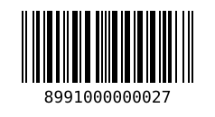
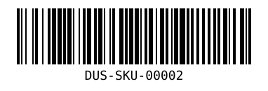
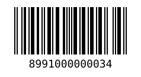
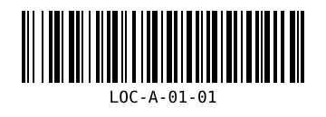
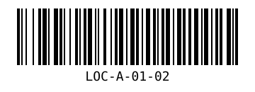
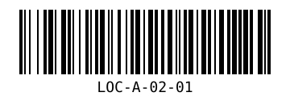

# Alur uji dengan HP sebagai scanner

Alur ini menguji semua mode halaman `/scan` dari HP Android, memakai kamera HP sebagai scanner. Setiap langkah
menampilkan barcode yang perlu discan, jadi cukup buka dokumen ini di layar laptop dan arahkan kamera HP ke
barcodenya.

Langkah-langkahnya berantai. Stok yang masuk di langkah 1 dipakai di langkah berikutnya, jadi jalankan secara
berurutan.

Penyiapan HP dan laptop ada di [panduan-hp-sebagai-scanner.md](../panduan-hp-sebagai-scanner.md).

## Persiapan

| Perangkat | Alamat | Masuk sebagai |
|---|---|---|
| HP | `http://localhost:8000/scan` | `staf01` / `password` |
| Laptop (panel) | `http://localhost:8000/admin` | `admin` untuk pesanan keluar, `supervisor` untuk opname (pakai jendela penyamaran atau keluar dulu untuk berganti user) |

Cara membuka dokumen ini dengan barcode tampil:
- **VS Code:** buka file ini, lalu tekan `Cmd+Shift+V` (Windows: `Ctrl+Shift+V`).
- **GitHub:** buka file ini di repositori.

Aturan scan:
- **Buka atau buat dokumen dulu, baru scan barang.** Di layar daftar dokumen, hasil scan dianggap nomor dokumen,
  sehingga barcode barang memunculkan "Dokumen tidak ditemukan".
- Barcode yang sama hanya dihitung sekali selama masih terlihat di kamera. Untuk menghitungnya lagi, jauhkan kamera
  sekitar 1 detik lalu arahkan kembali.
- Arahkan kamera sampai seluruh barcode masuk ke kotak. Bila hanya sebagian yang terbaca (misalnya `LO`), muncul
  "Barcode tidak dikenal". Dekatkan kamera lalu scan ulang.

Angka hasil di bawah berlaku untuk database baru (`php artisan migrate:fresh --seed`). Pada database yang sudah
pernah dipakai, periksa **perubahannya**, bukan angka akhirnya.

---

## 1. Penerimaan (UAT-01, 02, 03, 04, 05)

**1.1** Di HP pilih **Penerimaan**. Isi **Nama supplier** `PT Uji`, lalu ketuk **Penerimaan baru**. Judul atas
harus menampilkan nomor `GRN-…`. Ketuk **Scan pakai kamera**.

**1.2** Scan Minyak Goreng 1 L.

Hasil: kartu hijau, Minyak Goreng = **1** (UAT-01).

**1.3** Tahan kamera di barcode yang sama selama 2–3 detik.

Hasil: jumlah tetap **1** (UAT-04).

**1.4** Jauhkan kamera sekitar 1 detik, lalu scan lagi.

Hasil: Minyak Goreng = **2**.

**1.5** Scan dus Minyak Goreng (1 dus = 12 pcs).

Hasil: Minyak Goreng = **14** (UAT-03).

**1.6** Scan dus Gula Pasir (1 dus = 24 pcs), lalu satu pcs Gula Pasir.

Hasil: Gula Pasir = **25**.

**1.7** Scan barcode yang tidak terdaftar.

Hasil: kartu oranye "Barcode tidak dikenal" dengan nada rendah. Jumlah barang tidak berubah (UAT-02).

**1.8** Tutup kamera, lalu ketuk **Simpan Draft**. Di laptop, buka **Laporan › Stok per Lokasi**.

Hasil: stok Minyak Goreng dan Gula Pasir **belum bertambah** (UAT-05).

**1.9** Di HP, buka lagi penerimaan tadi, lalu ketuk **Selesai, lanjut Putaway**.

Hasil: stok masuk ke area terima `RCV-01` (Minyak Goreng +14, Gula Pasir +25), dan layar putaway terbuka.

---

## 2. Putaway (UAT-06)

**2.1** Bila layar putaway belum terbuka, pilih mode **Putaway** lalu pilih dokumen `PUT-…`. Ketuk **Scan pakai
kamera**, lalu scan rak tujuan A-01-01.

**2.2** Scan dus Minyak Goreng, lalu satu pcs Minyak Goreng dua kali (jauhkan kamera di antaranya).

Hasil: 14 Minyak Goreng ditaruh di A-01-01.

**2.3** Ketuk **Ganti lokasi**, lalu scan rak A-01-02.

**2.4** Scan dus Gula Pasir, lalu satu pcs Gula Pasir.

Hasil: 25 Gula Pasir ditaruh di A-01-02.

**2.5** Ketuk **Selesai**.

Hasil: di **Stok per Lokasi**, stok pindah dari RCV-01 ke A-01-01 (Minyak Goreng 14) dan A-01-02 (Gula Pasir 25).

---

## 3. Transfer (UAT-13)

**3.1** Pilih mode **Transfer**, ketuk **Transfer baru**, lalu **Scan pakai kamera**. Scan lokasi asal A-01-01.

**3.2** Scan lokasi tujuan A-02-01.

**3.3** Scan Minyak Goreng dua kali (jauhkan kamera di antaranya).

**3.4** Ketuk **Selesai**.

Hasil: Minyak Goreng di A-01-01 = **12**, di A-02-01 = **2**.

---

## 4. Picking (UAT-07, 08, 09, 12)

**4.1** **Laptop, sebagai `admin`:** buka **Dokumen › Pesanan Keluar**, lalu buat pesanan untuk pelanggan
`Toko Uji` dengan satu baris: Minyak Goreng 1 L, qty **5**. Simpan, lalu jalankan **Rilis ke picking**.

**4.2** **HP:** pilih mode **Picking**, lalu pilih pesanan tadi.

Hasil: daftar ambil muncul dengan lokasi **A-01-01** (UAT-07). Ketuk **Scan pakai kamera**.

**4.3** Scan lokasi yang salah.

Hasil: kartu oranye **Lokasi salah** dengan pesan "Lokasi A-02-01 tidak ada di daftar picking" (UAT-09).

**4.4** Scan lokasi yang benar.

**4.5** Scan barang yang tidak ada di pesanan.

Hasil: kartu oranye **Barang tidak sesuai** (UAT-08).

**4.6** Scan dus Minyak Goreng (12 pcs, padahal pesanan 5).

Hasil: kartu oranye **Melebihi pesanan**. Qty picking tetap 0.

**4.7** Scan Minyak Goreng **lima kali**, jauhkan kamera di antara setiap scan.

Hasil: picking Minyak Goreng = **5** dari 5.

UAT-12 (ambil melebihi stok lokasi) menuntut stok di lokasi sudah dipesan dokumen lain. Skenario itu sudah dicakup
test otomatis dan tidak diulang di sini.

---

## 5. Packing dan kirim (UAT-10, 11)

**5.1** Pilih mode **Packing**, lalu pilih pesanan yang sama. Ketuk **Scan pakai kamera**, lalu scan Minyak Goreng
**empat kali**.

**5.2** Tutup kamera, lalu ketuk **Kirim**.

Hasil: kiriman ditolak dengan pesan **Qty tidak cocok** (UAT-10). Stok tidak berubah.

**5.3** Buka kamera lagi, lalu scan Minyak Goreng **sekali lagi** sampai packing = 5.

**5.4** Tutup kamera, lalu ketuk **Kirim**.

Hasil: pesanan selesai, surat jalan bisa diunduh, dan Minyak Goreng di A-01-01 turun dari 12 menjadi **7**
(UAT-11).

---

## 6. Stock opname (UAT-14, 16, 17)

**6.1** **Laptop, sebagai `supervisor`:** buka **Dokumen › Stock Opname**, lalu buat opname baru. Pada
**Lokasi atau zona** pilih `A-01-02`, lalu simpan.

**6.2** **HP:** pilih mode **Stock Opname**, lalu pilih dokumen `OPN-…`. Ketuk **Scan pakai kamera**, lalu scan
lokasi A-01-02.

Hasil: layar **tidak menampilkan** qty sistem (UAT-14, opname hitung buta).

**6.3** Scan dus Gula Pasir (24 pcs).

Hasil: hitungan fisik Gula Pasir = **24**, padahal di sistem ada 25.

**6.4** Tutup kamera, lalu ketuk **Simpan, lokasi berikutnya** dan **Ajukan ke supervisor**.

**6.5** **Laptop, sebagai `supervisor`:** buka opname tadi. Jalankan **Setujui selisih** dengan alasan
dikosongkan.

Hasil: persetujuan ditolak, alasan wajib diisi (UAT-17).

**6.6** Jalankan **Setujui selisih** lagi dengan alasan `1 pcs rusak`.

Hasil: dokumen Penyesuaian `ADJ-…` terbentuk, dan Gula Pasir di A-01-02 menjadi **24** (UAT-16).

---

## 7. Cek akhir di panel

**Laporan › Kartu Stok**, barang Minyak Goreng 1 L, harus berisi transaksi berikut secara berurutan:

1. Penerimaan +14 di RCV-01
2. Putaway RCV-01 → A-01-01, 14
3. Transfer A-01-01 → A-02-01, 2
4. Kirim −5 dari A-01-01

**Laporan › Stok per Lokasi** harus menampilkan:

| Barang | Lokasi | Qty |
|---|---|---|
| Minyak Goreng 1 L | A-01-01 | 7 |
| Minyak Goreng 1 L | A-02-01 | 2 |
| Gula Pasir 1 kg | A-01-02 | 24 |

## Mencatat hasil

Catat hasil setiap UAT di [checklist-uat.csv](checklist-uat.csv). Bila hasil sebuah langkah berbeda, catat:
nomor langkah, barcode yang discan, pesan yang muncul, dan tangkapan layar HP.
